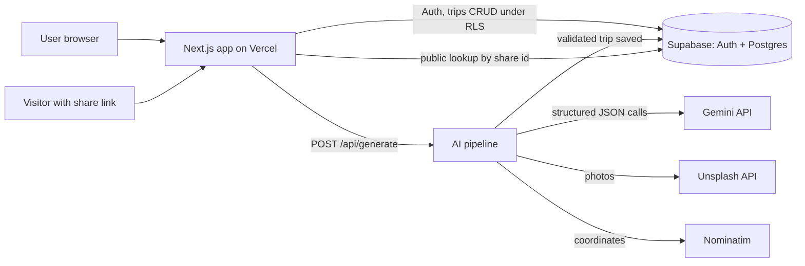

# TripAi: AI Travel Itinerary Planner

Plan a complete trip anywhere in the world in seconds. Enter a destination, budget, number of days and currency (plus optional travel style, group size and starting city), and TripAi generates a day-by-day itinerary with transport options, hotels near each day's stops, local transport and a budget breakdown. Everything is shown as image-rich cards on a timeline with sticky-note style notes you can edit, save and share.

**Live demo:** https://trip-ai-pied.vercel.app

---

## Features

- **AI trip generation** from destination, budget, days, currency, travel style, group size and starting city
- **Day-by-day itinerary** with time slots, durations, estimated costs and local tips
- **Getting there** options (train, bus, flight) with approximate costs, tagged "best value" or "fastest"
- **Hotels near each day's stops** and typical local transport costs
- **Budget breakdown** (transport, stay, food, activities, misc) that updates live as you edit
- **Trip map** with a pin for each stop, route lines and a day filter
- **Edit mode:** drag and drop activities between days, edit time, duration and cost, add or remove stops, change hotels
- **Sticky notes** on every activity and day, editable and saved with the trip
- **Currency support:** the whole plan is generated and shown in the user's chosen currency
- **Save and manage trips** (rename, duplicate, delete, search, filter, sort)
- **Share a trip** with a public read-only link that can be turned off anytime; visitors can save their own editable copy
- **Explore** curated trips by interest and by season
- **Auth** with email and Google sign-in
- **Booking links** to partner search pages for tickets and hotels (affiliate-style links, no payments handled in the app)

---

## Tech Stack

| Area | Tools |
|---|---|
| Framework | Next.js (App Router), React, TypeScript |
| Styling and UI | Tailwind CSS, shadcn/ui, Lucide icons |
| Animation | Framer Motion |
| Interaction | dnd-kit (drag and drop) |
| Forms and validation | React Hook Form, Zod |
| State | Zustand |
| Charts and maps | Recharts, React Leaflet with OpenStreetMap |
| Auth and database | Supabase (Auth, Postgres, Row Level Security) |
| AI | Google Gemini API (Flash-Lite model) via `@google/genai` |
| Images and geocoding | Unsplash API, Nominatim (OpenStreetMap) |
| Deployment | Vercel |

---

## Architecture



### How a trip is generated

1. **Input validation:** form values are validated with Zod, length-limited and stripped of control characters. User text is treated as data inside delimited fields, never as instructions.
2. **Stage 1, getting there:** transport options from the starting city (skipped if none is given).
3. **Stage 2, itinerary:** day-by-day activities with time slots, durations, estimated costs, approximate coordinates and a short local tip.
4. **Stage 3, stays and local transport:** one hotel per day near that day's stops, plus typical local transport and daily food and misc estimates.
5. **Budget assembly in code:** all totals and category sums are computed on the server, never taken from the model. Sanity checks compare hotel and activity prices with the budget, and if the plan is over budget or a check fails, one adjustment call swaps or trims items and the totals are recomputed.
6. **Enrichment:** photos and coordinates are added from Unsplash and Nominatim. A failure here never fails the generation.
7. **Save:** the validated trip is stored for the signed-in user.

### Reliability and safety decisions

- Every model response is parsed with a **Zod schema**; on failure it retries once with the validation error included, then returns a clean error.
- **Rate-limit (429) handling** with backoff and a friendly "try again soon" state.
- **Arithmetic is done in code**, not by the model.
- **Currency-aware prompts:** the model is told the currency and the per-day budget, so prices match the budget instead of defaulting to typical tourist prices in dollars.
- **Images are verified for relevance** to the destination before use, and placeholders are preferred over wrong photos.
- **Row Level Security** on every table: users can only read and change their own trips.
- **Public sharing** goes through a restricted lookup that returns only the plan data, never the owner's identity, using unguessable share ids. Shared pages are `noindex`.
- **API keys stay on the server;** no secrets are exposed to the client.

---

## Running Locally

**Prerequisites:** Node.js 20 or newer, a Supabase project, a Gemini API key and an Unsplash API key.

```bash
git clone https://github.com/rishabhsurpariya/TripAI.git
cd TripAI
npm install
cp .env.example .env.local
# fill in the values in .env.local
npm run dev
```

Open http://localhost:3000.

### Environment variables

| Variable | Purpose |
|---|---|
| `NEXT_PUBLIC_SUPABASE_URL` | Supabase project URL |
| `NEXT_PUBLIC_SUPABASE_ANON_KEY` | Supabase public (anon) key |
| `NEXT_PUBLIC_SITE_URL` | The site's own URL (used for auth redirects) |
| `NEXT_PUBLIC_USE_MOCK_DATA` | `true` to run on mock data, `false` for the real backend |
| `GEMINI_API_KEY` | Google Gemini API key (server only) |
| `GEMINI_MODEL` | Optional model override |
| `UNSPLASH_ACCESS_KEY` | Unsplash API key (server only) |

### Database setup

Run the provided SQL migration files in the Supabase SQL Editor, in order. They create the `trips` table, the Row Level Security policies, the public share lookup function and the `currency` column.

### Authentication setup

In Supabase, set the Site URL and add your redirect URLs under Authentication, URL Configuration (include `http://localhost:3000/**` for local development). For Google sign-in, create an OAuth client in Google Cloud and add the Supabase callback URL as its redirect URI.

---

## Known Limitations

- **Prices are estimates.** The AI has no live data, so fares, hotel prices and opening hours are approximate, and the app says so.
- **Images are illustrative stock photos** from Unsplash and may not show the exact place.
- **Free-tier limits.** The AI quota is small and shared by all users, and the app has no per-user usage limits yet.
- **No real booking.** Booking buttons open partner search pages; no payments or availability checks happen in the app.
- **Sharing a trip** exposes its plan to anyone with the link until sharing is turned off.

## Roadmap

- Per-user usage limits and rate limiting
- Regenerate a single day while keeping notes
- Email confirmation flow
- Streaming progress during generation
- Real place photos and ratings

---

## What I Learned

This project taught me that the model is only one part of an AI product: most of the work was making its output trustworthy. I moved arithmetic out of the model and into code, validated every response against a schema, and split generation into small stages so each one was easier to check and retry. A few early problems shaped those decisions, such as prices coming back in dollars until I made the prompts currency- and budget-aware, and photos that didn't match the destination until I added a relevance filter. I also learned to design for quotas, because a free API tier forced me to count requests per trip and choose a model with a workable daily limit. On the backend, writing Row Level Security so private trips and public share links could coexist taught me to think about what each request is allowed to see. Finally, deploying showed me how many issues only appear in production, from auth redirect URLs to environment variables and git settings.

## Author

**Rishabh Surpariya**: [LinkedIn](https://www.linkedin.com/in/rishabhsurpariya) · [Portfolio](https://rishabhsurpariya.netlify.app) · [Email](mailto:rishabhsurpariya@gmail.com)

## Acknowledgements

Photos from [Unsplash](https://unsplash.com). Map data © OpenStreetMap contributors.
